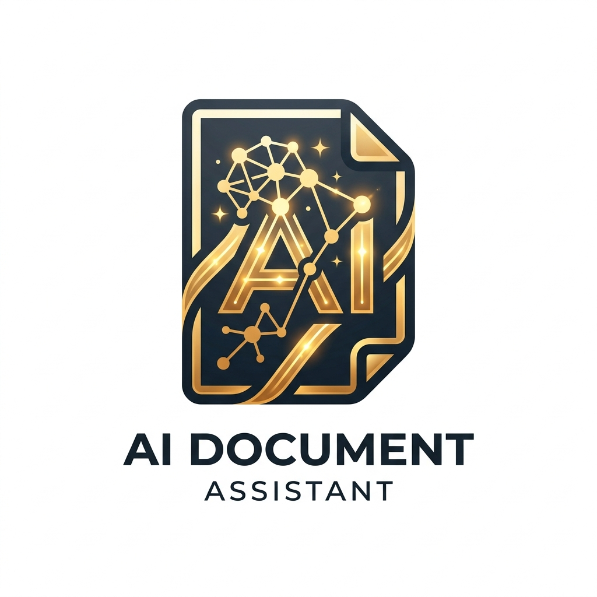

# AI Document Assistant — Portfolio Edition

An enterprise-grade, portfolio-ready **AI Document Assistant** inspired by modern document intelligence platforms (such as *AskYourPDF*). Users can upload documents (including scanned PDFs), ask complex questions, and receive articulate, factually grounded answers with verified in-text citations (`[Page X]`) and interactive document preview.



---

## 🌟 Key Highlights & Requirements Delivered

| Requirement | Implementation Detail | Status |
| :--- | :--- | :---: |
| **1. PDF Extraction & OCR** | PyMuPDF (`fitz`) for digital text + layout extraction; automated fallback to **Tesseract OCR** for scanned pages and images. | ✅ Complete |
| **2. Chunking & Embeddings** | Recursive semantic character splitting with configurable overlap; **Sentence Transformers** (`all-MiniLM-L6-v2`) generating 384-d dense vectors. | ✅ Complete |
| **3. Semantic Retrieval** | **pgvector** cosine distance (`<=>`) in PostgreSQL with high-performance NumPy cosine similarity fallback for offline/development environments. | ✅ Complete |
| **4. Grounded RAG & Citations** | Strict anti-hallucination prompt engineering requiring in-text `[Page X]` citations and structured citation metadata cards. | ✅ Complete |
| **5. Database & History** | SQLAlchemy models for Documents, Chunks, Chat Sessions, Messages, and User Feedback (PostgreSQL + SQLite auto-fallback). | ✅ Complete |
| **6. Testing & Deployment** | Pytest test suite covering all services and API endpoints; production-ready **Docker** & **docker-compose.yml**. | ✅ Complete |

---

## 🏗️ Architecture & Pipeline Flow

```mermaid
flowchart TD
    A[User PDF Upload] --> B[PyMuPDF Page Parser]
    B --> C{Digital Text Density?}
    C -->|High Density| D[Text & Block Extraction]
    C -->|Low / Scanned Page| E[Tesseract OCR Engine]
    E --> D
    D --> F[Recursive Semantic Chunker]
    F -->|Track Page Numbers| G[Sentence Transformers]
    G -->|384-d Vectors| H[(pgvector / Vector Store)]
    
    I[User Question] --> J[Query Embedding]
    J --> K[Vector Cosine Similarity Search]
    H --> K
    K -->|Top-K Chunks + Page Metas| L[Grounded RAG Synthesizer]
    L -->|Strict Anti-Hallucination & Citations| M[AI Assistant Answer with [Page X] Citations]
    M --> N[Interactive PDF Viewer & Chat Pane]
```

---

## 💻 Tech Stack

- **Frontend**: Next.js 16 (App Router), React 19, TypeScript, Vanilla CSS Design System.
- **Backend**: Python 3.12, FastAPI, Uvicorn, Pydantic Settings.
- **Document Processing**: PyMuPDF (`pymupdf`), Tesseract OCR (`pytesseract`), Pillow.
- **Embeddings & Vector Search**: FastEmbed / Sentence Transformers (`all-MiniLM-L6-v2`), pgvector, NumPy.
- **Database**: PostgreSQL (with pgvector extension) & SQLite fallback with async SQLAlchemy.
- **LLM Integrations**: OpenAI (`gpt-4o`, `gpt-4o-mini`), Google Gemini (`gemini-1.5-flash`), Groq, local Ollama, and built-in Grounded Fallback Synthesizer.
- **Testing & Packaging**: Pytest, Pytest-Asyncio, HTTPX, Multi-stage Docker, Docker Compose.

---

## 🎨 UI Design & Reference Alignment

The user interface matches the clean split-screen layout:
1. **Slim Left Dock**: High-contrast dark navigation dock with logo, unread notification counter, API documentation shortcut, and settings.
2. **Conversation Sidebar**: Searchable conversation history categorized by `TODAY` and `YESTERDAY` with `+New Conversation` creation and management.
3. **Top Navigation Bar**: LLM model selector pills (`GPT-3.5`, `GPT-4`, `Claude`, `Claude 2`, `Local / Ollama`), language selector, credit pill, and document manager drawer.
4. **Interactive Document Viewer**: Paper canvas displaying pages with academic formatting, watermark headers, zoom controls, and a floating selection popup (`Explain`, `Summarise`, `Rewrite`).
5. **Grounded Chat Interface**:
   - Assistant responses with clickable `[Page X]` tags that immediately highlight and scroll to that page in the document viewer.
   - Expandable **Grounded Citations** accordion with supporting snippets and cosine match percentages.
   - Thumbs up / thumbs down feedback controls and one-click copy.
   - Quick prompt suggestion chips.

---

## 🚀 Quickstart Guide

### Option 1: Docker Compose (Full Stack with PostgreSQL & pgvector)

```bash
# Clone and navigate to workspace
cd "AI Document  Assistant"

# Launch all services
docker compose up --build
```
- Frontend: `http://localhost:3000`
- Backend API Docs: `http://localhost:8000/docs`

---

### Option 2: Local Development (Instant Setup)

#### 1. Backend Setup (FastAPI)
```bash
cd backend
python -m pip install -r requirements.txt
python -m uvicorn app.main:app --port 8000 --reload
```
*Note: If PostgreSQL is not active, the backend automatically utilizes SQLite fallback with zero configuration needed.*

#### 2. Frontend Setup (Next.js)
```bash
cd frontend
npm install
npm run dev
```
Open `http://localhost:3000` in your browser.

---

## 🧪 Running Automated Tests

A comprehensive test suite validates the PDF extractor, OCR trigger, chunking, embeddings, RAG answering, and API endpoints:

```bash
python -m pytest backend/tests
```

**Test Coverage Highlights:**
- `test_pdf_processor.py`: Tests PyMuPDF text parsing, scanned page handling, and metadata preservation.
- `test_chunking.py`: Tests recursive character splitting, overlap boundaries, and 1-indexed page tagging.
- `test_embeddings.py`: Tests 384-dimensional dense vectors, batch embeddings, and mathematical cosine similarity.
- `test_rag_pipeline.py`: Tests anti-hallucination prompting, citation formatting, and inline document actions (`explain`, `summarise`, `rewrite`).
- `test_api.py`: Tests `/health`, `/upload`, `/chat/message`, `/feedback`, and HTTP error handling.

---

## 📖 API Endpoints Summary

- `GET /health`: System diagnostics (DB engine, Tesseract OCR version, embedding model, doc counts).
- `POST /api/v1/documents/upload`: Uploads PDF, applies OCR if needed, extracts chunks, generates embeddings.
- `GET /api/v1/documents`: Lists all indexed documents with page and chunk counts.
- `GET /api/v1/documents/{id}/chunks`: Retrieves chunks for a document with page filtering.
- `GET /api/v1/documents/{id}/file`: Streams the PDF file for viewer rendering.
- `GET /api/v1/chat/sessions`: Lists conversation sessions ordered by activity.
- `POST /api/v1/chat/sessions`: Creates a new conversation thread.
- `POST /api/v1/chat/message`: Submits user question, performs semantic search, and returns grounded answer with page citations.
- `POST /api/v1/chat/message/{id}/feedback`: Records user thumbs up / thumbs down.
- `POST /api/v1/chat/text-action`: Executes inline document actions (`explain`, `summarise`, `rewrite`).
